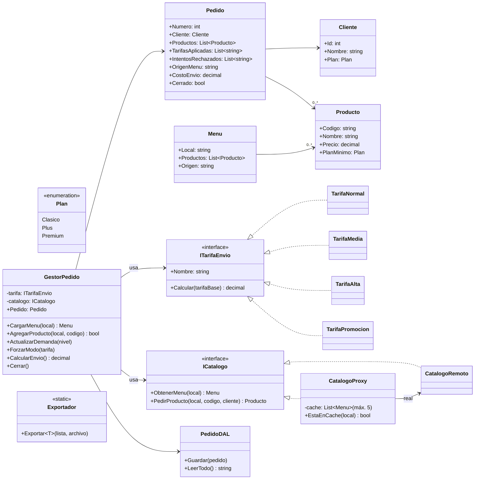

# YaLlega S.A. – Diagrama de clases

Patrones: **Strategy** (tarifas de envío), **Proxy** (catálogo remoto: plan del cliente + caché de 5 menús), **genéricos + reflection** (exportador para cualquier clase).

**Capas y referencias:** UI → BLL → DAL; todas → DomainModel. Services (Exportador) lo usa la UI.
